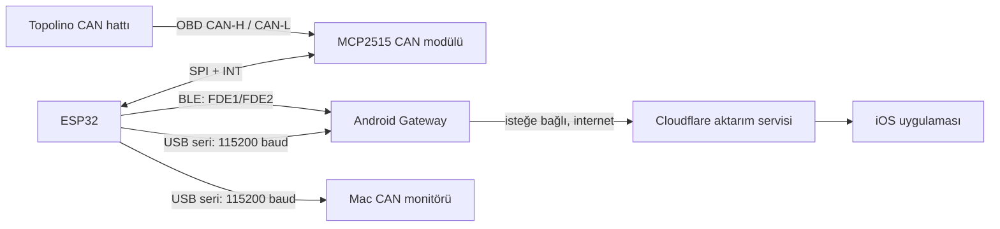
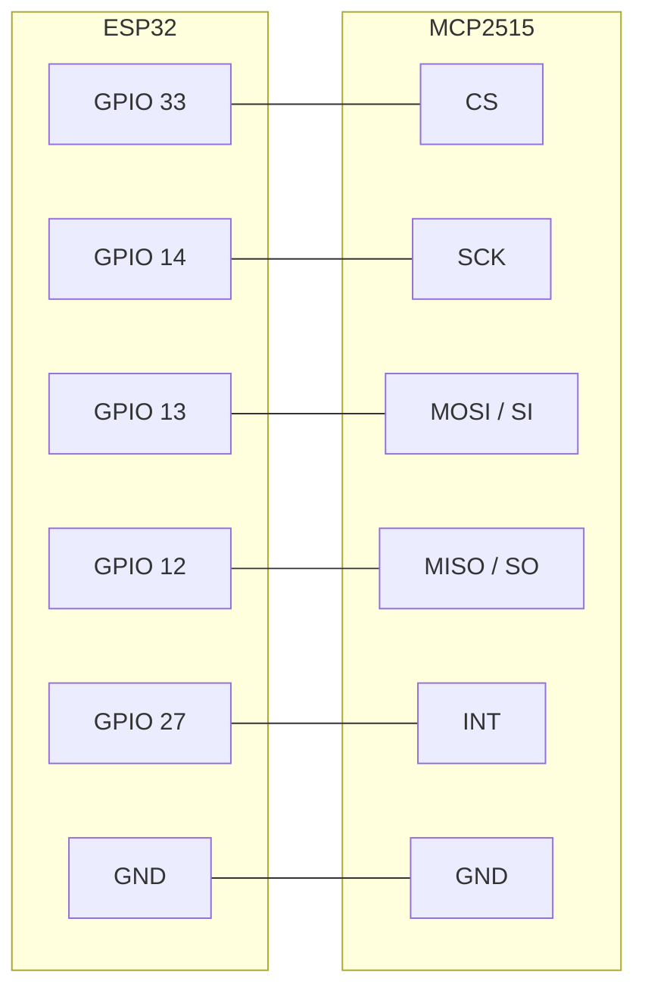
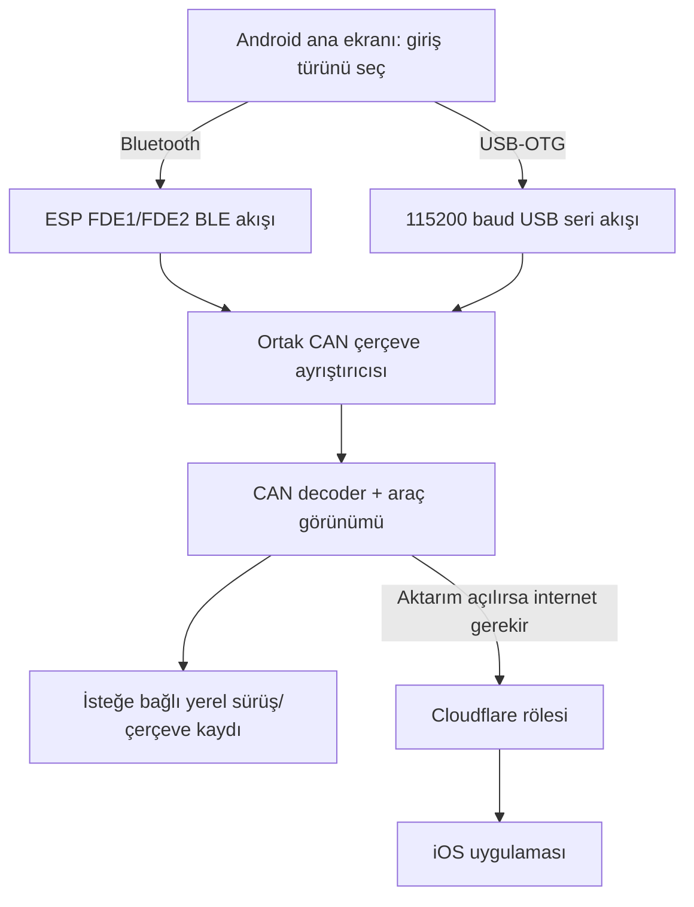

# Topolino Connect: sıfırdan kullanım ve bağlantı rehberi

Bu rehber, uygulama ve elektronik konusunda ön bilgisi olmayan biri için yazıldı. İlk kurulumda aracı hareket ettirmeyin; masa üzerinde ESP32 ve CAN modülünü kullanın. CAN hattına yanlış bağlantı araç elektroniğine zarar verebilir.

## Proje ne yapıyor?

ESP32, MCP2515 CAN modülü üzerinden aracın CAN hattını yalnızca dinler. Android telefona iki yoldan biriyle veri aktarır: BLE kablosuz bağlantı veya USB-OTG kablolu bağlantı. Android, CAN çerçevelerini çözer; seçilirse internet üzerinden iOS uygulamasına aktarır. Mac uygulaması ESP32'nin USB seri çıktısını gösterir.

## Parçaları birbirine bağlama

Bu pin tablosu, depodaki firmware'in `HWv2` ayarı içindir. ESP32 DevKit ile MCP2515 modülünün pinlerini eşleştirir:

| MCP2515 kartı | ESP32 DevKit pini | Ne işe yarıyor? |
|---|---:|---|
| CS | GPIO 33 | SPI cihaz seçimi |
| SCK | GPIO 14 | SPI saat |
| MOSI / SI | GPIO 13 | ESP32'den CAN modülüne veri |
| MISO / SO | GPIO 12 | CAN modülünden ESP32'ye veri |
| INT | GPIO 27 | Yeni CAN mesajı kesmesi |
| GND | GND | Ortak toprak |
| VCC | Kart üzerindeki regülatör/lojik tipine göre | Güç; aşağıdaki uyarıyı okuyun |

**Güç konusunda tahmin yürütmeyin:** MCP2515 kartlarının bazıları 5 V ile beslenir ama ESP32'nin GPIO'ları 5 V toleranslı değildir. Kartta 3.3 V lojik dönüştürücü/regülatör olup olmadığını kart üzerindeki parça numarasından doğrulayın. MCP modülünün besleme ve lojik seviyesini doğrulamadan 5 V'u VCC'ye veya herhangi bir GPIO'ya bağlamayın. ESP32'yi ilk masa testinde kendi USB'sinden besleyin. OBD soketinin 16 numaralı pini araç aküsüdür; ESP32 GPIO'suna kesinlikle bağlanmaz. OBD'de yalnız CAN-H (6) ve CAN-L (14) hatlarını, GND'yi ise yalnız doğru şase bağlantı noktasına bağlayın.

Firmware MCP2515'te 8 MHz kristal ve 500 kbit/s CAN hızı bekler, alıcıyı dinleme modunda açar ve CAN'a komut göndermez. Donanım kartındaki kristal frekansını kontrol edin; farklıysa firmware ayarı da eşleşmelidir.

## İlk başlatma

1. ESP32'yi USB ile bilgisayara bağlayın; araç OBD soketine henüz bağlamayın.
2. Firmware seri çıkışını açın. Seri hız 115200 baud olmalıdır.
3. `CAN-Module initialized` benzeri başarılı başlatma satırını görün. Başlatma hatası varsa kablo/pin/kristal/besleme doğrulanmadan araca takmayın.
4. Android'de **Bluetooth** veya **USB-OTG** modlarından yalnızca birini seçin. Mod değişince önceki giriş kapatılır; ikisi aynı anda çalışmaz.
5. BLE için ESP yayınını seçin. OTG için telefonun USB-C girişine OTG adaptörü ve ESP'nin USB kablosunu takın; ekranda listelenen seri cihazlardan ESP'yi seçip Android USB iznini verin.
6. Ekranda önce çerçeve sayacının, sonra çözülen alanların güncellendiğini doğrulayın. Ham CAN çerçevesi görmek, her sinyalin anlamının doğrulandığı anlamına gelmez.

## Telefon ve bağlantı şeması

### Bir şey çalışmazsa

- **USB listesi boş:** telefon USB host/OTG desteklemeli; OTG adaptörünü ve ESP'nin veri taşıyan USB kablosunu deneyin. Yalnız şarj kablosu veri taşımaz.
- **Cihaz var ama seri sürücü yok:** ESP kartının USB-UART yongası CP210x, CH340, FTDI veya CDC/ACM olmalıdır; arızalı/alışılmadık dönüştürücüler tanınmayabilir.
- **Bağlı ama CAN yok:** MCP2515 beslemesini, ortak GND'yi, GPIO eşleşmesini, 8 MHz kristali ve araç CAN-H/L uçlarını kontrol edin.
- **Alanlar boş:** uygulama ham çerçeveyi gösterebilir ama henüz bilinmeyen/aday DBC sinyallerini kesin değer gibi sunmaz. Yeni bir sinyal için kayıt ve araç göstergesiyle eşzamanlı doğrulama gerekir.
- **Ekran kapanınca veri kesiliyor:** Android uygulamasının bildirim iznini verin ve cihaz pil ayarlarında uygulama için arka plan kısıtını kaldırın. Üretici pil tasarrufu ayarları arka plan BLE/USB'yi yine durdurabilir.

## Kod haritası

| Klasör | İçerik |
|---|---|
| `AndroidGateway/app` | Android ekranları, BLE servisi, USB-OTG seri okuma, CAN decoder ve testler |
| `TopolinoInfoDisplay_Firmware` | ESP32/MCP2515 dinleyici firmware'i |
| `MacApp` | Mac'te USB seri CAN monitörü |
| `MyCitroenPort` | Android aktarım servisini kullanan iOS/watch uygulaması |
| `AndroidGateway/relay` | İsteğe bağlı Cloudflare veya yerel aktarım hizmeti |

Futbol uygulaması bu depodan bağımsız olarak `/Users/bseester/Desktop/futboldata` deposunun kökünde yer alır; Topolino uygulama paketi `TopolinoConnect/` altındadır. İki uygulamanın kodunu birbirine taşımayın.
