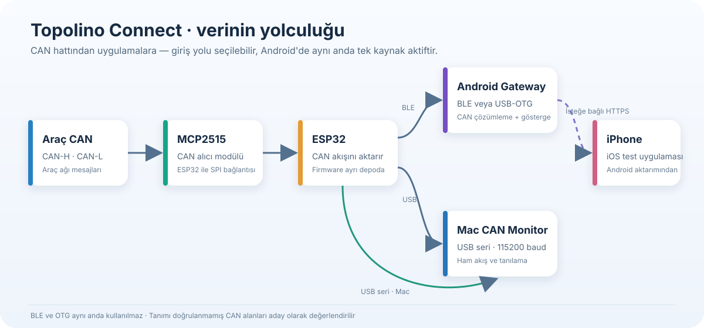
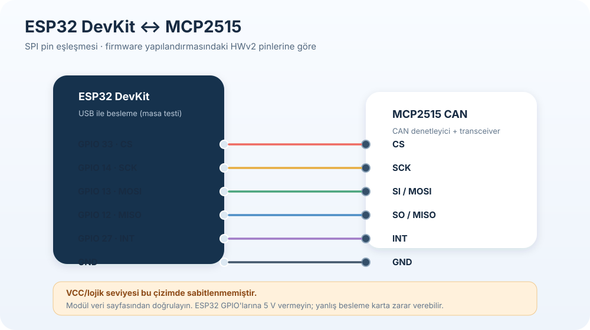
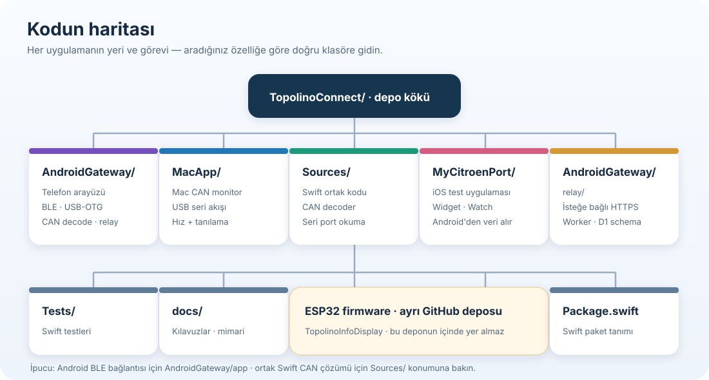

# Topolino Connect — görselli kullanım kılavuzu

Bu kılavuz ESP32 + MCP2515 donanımını, Android/Mac uygulamalarını ve isteğe bağlı iOS aktarımını ilk kez kuran kişi içindir. Her bağlantı adımını sırayla yapın; CAN verisi görmeden önce kabloyu ve giriş kaynağını doğrulayın.

## 1. Sistem nasıl çalışır?



ESP32, MCP2515 modülüyle CAN hattını dinler ve verileri Bluetooth LE veya USB seri üzerinden dışarı verir. Android aynı anda sadece bir giriş kullanır: **Bluetooth** ya da **USB-OTG**. Mac uygulaması USB seri akışını gösterir. iOS uygulaması, Android'de açılan isteğe bağlı internet aktarımından veri alır.

## 2. Kablolama



| MCP2515 | ESP32 DevKit | Açıklama |
|---|---:|---|
| CS | GPIO 33 | Modül seçimi |
| SCK | GPIO 14 | SPI saat |
| MOSI / SI | GPIO 13 | ESP32'den modüle veri |
| MISO / SO | GPIO 12 | Modülden ESP32'ye veri |
| INT | GPIO 27 | CAN mesajı bildirimi |
| GND | GND | Ortak toprak |

**Gücü kartınıza göre doğrulayın.** MCP2515 modüllerinin VCC ve lojik seviyesi aynı değildir. Modülünüzün parça numarasını/veri sayfasını kontrol etmeden 5 V'u VCC'ye ya da ESP32 GPIO'suna vermeyin; ESP32 GPIO'ları 5 V toleranslı değildir. İlk masa testinde ESP32'yi USB'den besleyin. Araç bağlantısında yanlış güç veya şase bağlantısı elektroniklere zarar verebilir. Araç soketindeki CAN-H/CAN-L ve şase pinlerini yalnızca araç/modelin doğrulanmış şemasından teyit edin.

## 3. İlk açılış ve bağlantı

1. ESP32 ile MCP2515 arasındaki kabloları yukarıdaki tabloya göre kontrol edin. Modül üzerindeki kristal değerini de kontrol edin; firmware ayarıyla uyuşmalıdır.
2. ESP32'yi USB ile Mac'e bağlayın. Mac CAN Monitor'de ESP seri portunu seçin. Seri hız **115200 baud**.
3. Konsolda CAN modülünün başarıyla başlatıldığını ve çerçeve sayacının arttığını doğrulayın. Başlatma hatası varsa araca geçmeden pin, güç, ortak GND ve kristal ayarını gözden geçirin.
4. Android uygulamasını açıp **Bağlantı modu**ndan tek bir kaynak seçin:
   - **Bluetooth:** ESP'nin BLE yayınını/Topolino cihazını seçin, istenen Bluetooth izinlerini verin. Ekran kapalı kullanım için sürekli bildirim açık kalmalıdır.
   - **USB-OTG:** Bluetooth modu kapanır. Telefonun USB-C girişine OTG adaptörü, ardından ESP'nin veri taşıyan USB kablosunu takın. Android'in USB erişim isteğini onaylayın.
5. **Tüm CAN çerçeveleri ve ölçümler** ekranında sayaç ve son çerçeve zamanının güncellendiğini görün. Ham çerçeveler akıyorsa donanım-veri yolu çalışıyor demektir; çözümlenmeyen alanların boş veya aday görünmesi normaldir.
6. iOS aktarımı gerekiyorsa Android ana ekranda aktarımı etkinleştirin, erişim anahtarını güvenli biçimde iOS uygulamasının **Diğer → Android araç telefonu** bölümüne girin. Telefonların internet bağlantısı olmalıdır.

### Hangi uygulamayı ne zaman açmalı?

| Hedef | Bağlantı | Uygulama |
|---|---|---|
| ESP/CAN kablosunu ve ham akışı doğrulama | ESP32 → Mac USB | Mac CAN Monitor |
| Kablosuz veya kablolu telefonda araç verisi | ESP32 → Android BLE **veya** OTG | Android Gateway |
| Apple telefonda aktarılmış veriyi izleme | Android → internet aktarımı → iPhone | MyCitroën Port test uygulaması |

## 4. Proje klasörlerini tanıma



| Klasör/dosya | Ne içerir? | Ne zaman bakılır? |
|---|---|---|
| `AndroidGateway/app` | Android arayüzü, BLE/OTG bağlantısı, CAN çözücü, kayıt ve testler | Android bağlantısı veya ekranı değiştirirken |
| `AndroidGateway/relay` | İsteğe bağlı HTTPS aktarım servisi ve veritabanı şeması | Android'den iOS'a aktarım üzerinde çalışırken |
| `MacApp` | Mac seri CAN monitörünün arayüzü | USB akışını Mac'te izlerken |
| `Sources` | Swift CAN decoder ve seri monitör ortak kodu | Mac CAN çözümleme davranışını değiştirirken |
| `MyCitroenPort` | iOS, widget ve Watch uygulamaları | Apple uygulamasını geliştirirken |
| `Tests` ve `AndroidGateway/app/src/test` | Swift ve Android birim testleri | Decoder/parsing değişikliğinden sonra |
| `docs` | Mimari, başlangıç, geliştirme ve hata ayıklama kılavuzları | Projeyi öğrenirken veya katkı yaparken |

ESP32 firmware bu uygulama deposunda tutulmaz; ayrı [TopolinoInfoDisplay firmware deposunda](https://github.com/servicemensch/TopolinoInfoDisplay) geliştirilir. Bu depodaki Android/macOS/iOS kodunu değiştirmeniz ESP firmware'ini kendiliğinden güncellemez.

## 5. Hata bulma

| Belirti | Önce kontrol edin |
|---|---|
| MCP2515 başlatılamadı | CS/SPI/INT pin tablosu, ortak GND, besleme/lojik uyumu, kristal frekansı |
| Mac'te seri port yok | Veri taşıyan USB kablosu, doğru seri cihazı, USB-UART sürücüsü |
| BLE taraması ESP'yi bulmuyor | ESP açık mı, BLE firmware/yayını etkin mi, Bluetooth izinleri verilmiş mi, telefonda Bluetooth açık mı? |
| Android OTG cihazı bulmuyor | Telefon OTG desteği, OTG adaptörü, veri kablosu, Android USB izni |
| Bağlantı var ama CAN sayacı artmıyor | MCP bağlantısı, araç CAN-H/L eşleşmesi ve şase; araç ağı o sırada uyanık mı? |
| Ham çerçeveler var ama bir ölçüm yok | İlgili CAN kimliği/alanı bu araçta doğrulanmış mı? Bilinmeyen değerleri tahmin etmeyin; ham çerçeveyi tanılama ekranından inceleyin. |
| Telefon ekranı kapanınca bağlantı duruyor | Android ön plan bildirimi ve pil kısıtları; gerçek cihazda ekran kapalı denemesi yapın. Xiaomi/MIUI ek arka plan kısıtları uygulayabilir. |
| iOS veri almıyor | Android aktarımı açık mı, iki cihaz internetli mi, erişim anahtarı doğru mu, Worker/schema sürümü uyumlu mu? |

Tanılama bilgisi paylaşırken erişim anahtarını, ham araç kayıtlarını, VIN'i, GPS bilgisini ve cihaz kimliklerini eklemeyin. CAN alan eşleşmeleri araçta doğrulanana kadar aday kabul edilmelidir. Bu yazılım CAN'a komut göndermez; yine de kablolamayı ve araç soketini doğrulamadan bağlamayın.

## 6. Geliştirici için derleme ve doğrulama

Android klasöründe:

```sh
./gradlew testDebugUnitTest lintDebug assembleDebug
```

Worker testleri için `AndroidGateway/relay` içinde `npm test`; Swift ortak kodu için depo kökünde `swift test` çalıştırın. Yerel derlemenin başarılı olması BLE zamanlamasını, OTG donanım uyumunu, araç sinyallerini veya gerçek araç kablolamasını doğrulamaz. Sürüm öncesi adımlar [`RELEASE_CHECKLIST.md`](RELEASE_CHECKLIST.md) dosyasındadır.
