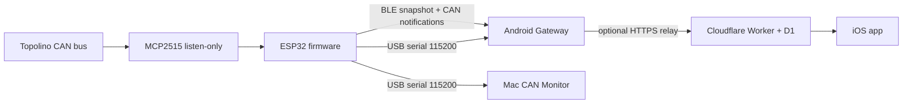

# Architecture

## Data flow

Android selects a single input source. Bluetooth and USB-OTG never run together. Both Android paths decode CAN frames locally and update the same vehicle snapshot. USB-OTG consumes the same serial frame stream as the Mac monitor. The optional relay forwards Android data to iOS.

## Signal confidence

The application receives CAN frames from the ESP. The CAN decoder interprets known IDs such as `0x580`, `0x581`, `0x582`, `0x593`, `0x594`, `0x713`, and `0x714`. Some bit positions have conflicting community references; those fields stay labeled as candidates until confirmed against a live frame and vehicle display. Unknown frames remain available as raw data.

The firmware listens at 500 kbit/s and does not send CAN commands. The CAN hardware and vehicle connection require the correct board wiring and common ground. Firmware compilation verifies the source builds; it does not verify physical wiring, CAN reception, radio range, or a decoded signal's meaning.

## Source ownership

- `AndroidGateway/app`: Android input selection, BLE foreground service, USB-OTG serial, CAN decoding, display and local capture.
- `AndroidGateway/relay`: optional Cloudflare Worker, D1 schema/migrations and tests.
- `MacApp` and `Sources`: Mac USB serial monitor and Swift CAN parsing helpers.
- `MyCitroenPort`: iOS, widget and watch application; vehicle data arrives through the Android relay.
- `docs/BEGINNER_GUIDE.md`: physical pin map and first-run instructions.
- ESP32 firmware is maintained in the separate `servicemensch/TopolinoInfoDisplay` repository.
